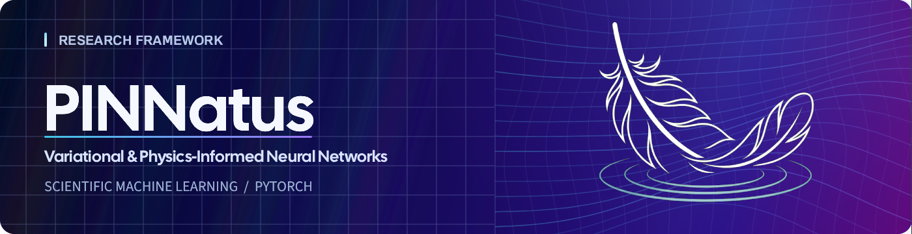

<p align="center">
  
  
  
  
  
</p>

<p align="center">
  <strong>A research-oriented framework for the study, development, and comparison of physics-informed neural methods.</strong>
</p>

> [!IMPORTANT]
> **Early-stage research project.** PINNatus is under active development. Its interfaces, numerical implementations, and documentation may change. It is not yet intended as a production-ready or generally validated solver.

## Overview and Academic Context

**PINNatus** is a scientific framework being developed in **Python** and **PyTorch** as a computational laboratory for research on **Variational Physics-Informed Neural Networks (VPINNs)**. Conventional **Physics-Informed Neural Networks (PINNs)** are included in its intended scope as reference methods for systematic comparisons.

Its development is motivated by my PhD research at the Universidade Tecnológica Federal do Paraná (UTFPR), within the academic environment of the Research Center for Rheology and Non-Newtonian Fluids (CERNN).

<sub><em>PINNATUS is a personal research initiative and is not an official software project of UTFPR or CERNN.</em></sub>

## Research scope

- **Variational formulations:** weak forms, test functions, numerical quadrature, and related approximation strategies.
- **PINN baselines:** strong-form approaches for controlled numerical comparisons.
- **Scientific benchmarking:** common physical problems, evaluation metrics, and reproducible experiments.
- **Methodological flexibility:** access to the mathematical and computational components needed to investigate and modify algorithms.

These are **development goals**, not a declaration that every feature is currently available.

## Architectural vision

The long-term goal is a modular interface that separates the physical problem, neural network, solution method, and training procedure.

```python
# Illustrative future API — not yet an implemented/stable interface.
problem = Poiseuille()
network = MLP(layers=[1, 32, 32, 1])

model = VPINN(
    problem=problem,
    network=network,
    test_functions=Legendre(degree=5),
)

trainer = Trainer(model=model, optimizer="Adam")
trainer.train()
```

The same physical problem should also support a conventional PINN formulation, enabling comparisons without redefining the governing problem.

## Design principles

| Principle | Intended approach |
| --- | --- |
| **Modularity** | Separate problem definitions, neural networks, numerical formulations, and training. |
| **Transparency** | Keep residuals, variational integrals, losses, and optimization procedures inspectable. |
| **Reproducibility** | Make experimental configurations and numerical comparisons traceable. |
| **Extensibility** | Support new VPINN formulations without rewriting the whole research environment. |

## Project status

PINNatus is currently in **early development**. The architecture and examples are evolving alongside the research. Installation instructions, validated examples, and API documentation will be added as the relevant components become available.

### References

The development of PINNatus draws inspiration from the following scientific machine learning frameworks:

[1] Lu, L., Meng, X., Mao, Z., & Karniadakis, G. E. (2021). **DeepXDE: A Deep Learning Library for Solving Differential Equations.** *SIAM Review*, 63(1), 208–228. https://doi.org/10.1137/19M1274067

[2] PhysicsNeMo Contributors. **NVIDIA PhysicsNeMo: An Open-Source Framework for Physics-Based Deep Learning in Science and Engineering.** NVIDIA. https://github.com/NVIDIA/physicsnemo

Additional methodological references are provided in the corresponding source code and documentation.

---

<p align="center"><sub>PINNatus pre-alpha · Scientific research in progress</sub></p>
